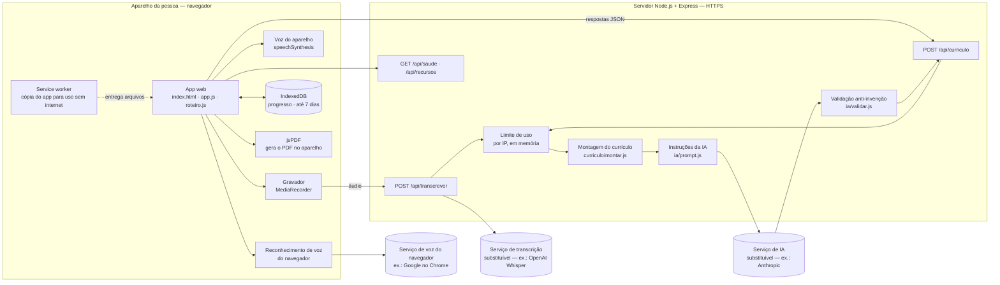
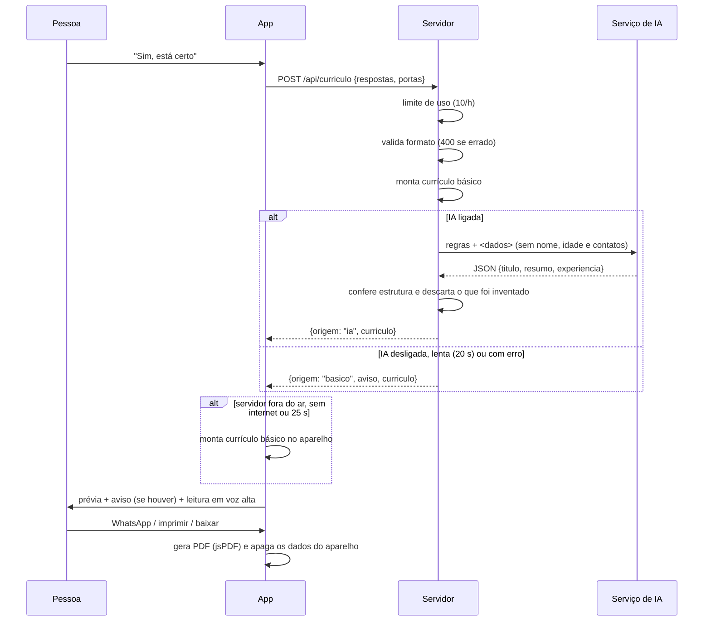
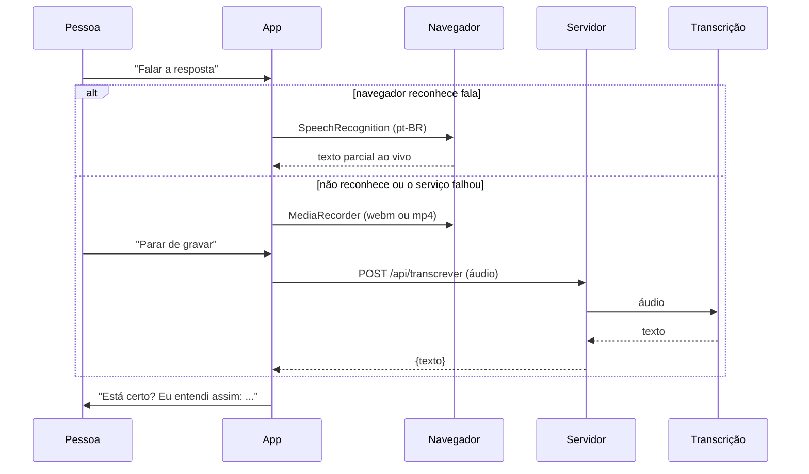

# Arquitetura técnica (tarefa 9.4)

> Como app, servidor, IA e transcrição se conectam. Rascunho para revisão.

## Visão geral

## Componentes

### App (pasta `prototipo`)

- JavaScript sem framework, para carregar rápido em celulares simples.
- `roteiro.js`: seções, perguntas, opções, obrigatoriedade e condições.
- `app.js`: navegação, estado, validações, voz, revisão, PDF e envio.
- `armazenamento.js`: grava o progresso no IndexedDB do aparelho.
- `sw.js`: guarda os arquivos do app para uso sem internet.
- `manifest.webmanifest`: permite instalar como app.

### Servidor (pasta `servidor`)

- Node.js 22 e Express 5, com `server.js` criando o app e as rotas.
- Entrega também a pasta `prototipo`, então app e API ficam no mesmo endereço.
- Não guarda dados: tudo fica só na memória durante o pedido.
- Logs só com o tipo do erro.

### Integrações substituíveis

| Integração | Pasta | Contrato | Implementações |
|---|---|---|---|
| IA | `servidor/ia/provedores/` | `gerar(pedido) → {titulo, resumo, experiencia[]}` | `anthropic`, `simulado`, `nenhum` |
| Transcrição | `servidor/transcricao/` | `transcrever(audio, tipo, sinal) → texto` | `openai`, `simulado`, `nenhum` |

Trocar de serviço é criar um arquivo novo com o mesmo contrato e mudar a
variável de ambiente (`IA_PROVEDOR` ou `TRANSCRICAO_PROVEDOR`).

## Sequência: gerar o currículo

## Sequência: responder por voz

## Segurança

| Ameaça | Proteção |
|---|---|
| Vazamento de chave de API | Chaves só em `.env` no servidor; `.env` no `.gitignore` |
| Resposta tentando mandar na IA ("ignore as regras") | Regras no `system`, respostas num bloco `<dados>` declarado como informação; validação posterior |
| IA inventando dados | `ia/validar.js` volta ao texto original quando aparecem números, nomes, idiomas ou carteira novos |
| Abuso da API | Limite por IP e tamanho máximo do pedido (50 KB JSON, 8 MB áudio) |
| Dados pessoais em logs | Logs só com o tipo do erro; teste automático confere |
| Outro site chamando a API | CORS fechado em produção |

## Tecnologias

| Camada | Tecnologia | Motivo |
|---|---|---|
| App | HTML, CSS e JavaScript sem framework | Leve e simples de manter |
| PDF | jsPDF 2.5.1 | Gera o PDF no aparelho, inclusive sem internet |
| Voz | Web Speech API, MediaRecorder | Recursos nativos do navegador |
| Armazenamento local | IndexedDB | Guarda objetos maiores que o localStorage, sem servidor |
| Servidor | Node.js 22, Express 5 | Mesma linguagem do app |
| IA | SDK oficial da Anthropic (substituível) | Resposta estruturada em JSON |
| Transcrição | API da OpenAI via `fetch` (substituível) | Custo e formatos (ver `docs/escolha-stt.md`) |
| Testes | `node --test` | Sem dependência extra |
| Hospedagem | Render (ver `docs/deploy.md`) | HTTPS e publicação automática |
