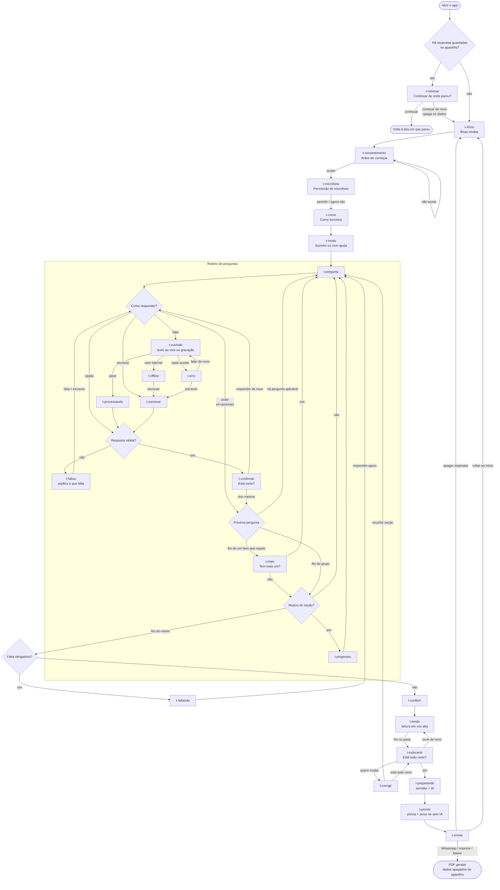
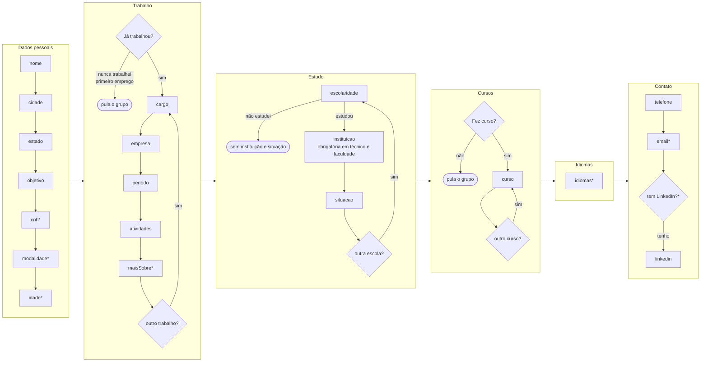

# Diagrama do fluxo (tarefa 9.2)

> Cobre as 24 telas de `prototipo/index.html`, com os desvios de primeiro
> emprego, repetição, validação, correção, falta de microfone e falta de internet.
> O diagrama usa Mermaid (o GitHub mostra como imagem).

## Fluxo geral

## Desvios do roteiro

`*` = pergunta opcional (pode pular).

## Diferenças entre os modos

| Comportamento | Sozinho | Com ajuda |
|---|---|---|
| Botão em primeiro lugar | Falar a resposta | Escrever a resposta |
| Leitura da pergunta | Pergunta, ajuda e opções, mais devagar | Só a pergunta |
| Repetição automática | Repete após 11 s sem ação (até 2 vezes) | Não repete |
| Exemplo de resposta na tela | Não | Sim |
